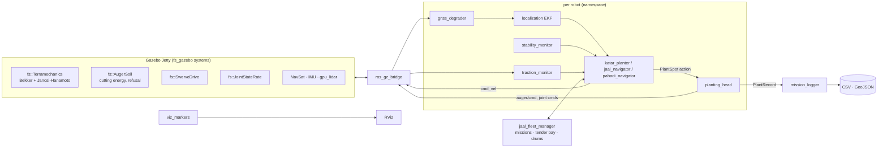

# ForestStark: afforestation robots

Three planting robots, each with a physics simulation and the software that would drive it:

| | Robot | Site | How it moves | Who decides where to stop |
|---|---|---|---|---|
| A | **Katar** (कतार, "row") | Roadsides, canal banks | 40 hp tractor + planting trailer, Ackermann steering | A driver steers. Software triggers stops every 3 m, and a boom sled and carriage put the auger on the spot |
| B | **Jaal** (जाल, "net") | Open blocks, 1–50 ha | Electric 4-wheel independent steer (swerve) | Fully autonomous fleet with a tender truck |
| C | **Pahadi** (पहाड़ी, "of the hills") | Slopes to ~25°, rocky land | Two tracked modules, steered articulation | Local autonomy on contour lines, operator on a tablet |

The workspace has two parts:

- **`ros2_ws/`**: ROS 2 Lyrical + Gazebo Jetty. Custom Gazebo systems for soil dynamics, robot models, and the autonomy stack: localization, planting head, planners, fleet logistics, stability and traction monitoring.
- **`sim/`**: a browser simulation lab (three.js + canvas) with the same physics constants and control logic, live engineering diagrams and the equations. It is the quick, shareable twin of the Gazebo stack.

---

## 1. Build

Requirements: Ubuntu 26.04, ROS 2 Lyrical with `ros_gz`, Gazebo Jetty (`gz sim` 10), `python3-numpy`, `python3-yaml`.

```bash
cd ~/Projects/ForestStark/ros2_ws
source /opt/ros/lyrical/setup.bash
colcon build --symlink-install
source install/setup.bash
```

Tests (C++ soil core, Python library, robot models):

```bash
colcon test --packages-select fs_gazebo fs_description && colcon test-result --verbose
PYTHONPATH=src/fs_autonomy:src/fs_gazebo python3 -m pytest -q src/fs_autonomy/test
```

## 2. Run

Each launch regenerates its site (world, soil map, survey file) from the arguments, starts Gazebo, spawns the robot(s), bridges topics and starts the autonomy. Add `headless:=true rviz:=false` to run without windows and `rtf:=3` to run faster than real time if the CPU allows.

```bash
ros2 launch fs_bringup katar.launch.py                         # stop-and-go, 3 m spacing, RTK
ros2 launch fs_bringup katar.launch.py mode:=on_the_move       # never stops; speed governed by sled travel
ros2 launch fs_bringup katar.launch.py surveyed:=false         # no utility survey: watch for cable strikes
ros2 launch fs_bringup katar.launch.py gnss:=standard          # plain GNSS instead of RTK

ros2 launch fs_bringup jaal.launch.py                          # 3 robots, 0.09 ha demo block
ros2 launch fs_bringup jaal.launch.py robots:=4 field:=full    # 1 ha, 1,111 spots
ros2 launch fs_bringup jaal.launch.py rtk_policy:=wait dropouts:=6

ros2 launch fs_bringup pahadi.launch.py                        # 14° slope, laterite, arm downhill
ros2 launch fs_bringup pahadi.launch.py slope:=22 side:=uphill rock_cover:=0.4
ros2 run fs_autonomy operator pause                            # the operator's tablet: pause|resume|skip|estop|release
```

Every planting attempt is written to `~/.ros/fs_logs/<site>-<time>/plants.csv` and `plants.geojson`, with coordinates, species, tool, soil, hole depth, boring energy, cycle time and placement error. A `summary.json` and, for Jaal, `fleet_timeline.csv` are written alongside.

The browser lab needs no build. Serve `sim/` and open it:

```bash
python3 -m http.server 8765 --directory sim
```

Then open `http://localhost:8765/preview.html` in a browser.

## 3. Architecture



### Packages

| Package | What is in it |
|---|---|
| `fs_interfaces` | `PlantRecord`, `HeadStatus`, `StabilityStatus`, `TractionStatus`, `Mission`, `Spot`, `RobotState`; action `PlantSpot`, action `TenderService`, service `ReserveBay` |
| `fs_gazebo` | C++ systems: `fs::Terramechanics`, `fs::AugerSoil`, `fs::SwerveDrive`, `fs::JointStateRate`; soil-map loader; site generator (`fs_gazebo.sites`) for the roadside, open-field and hill-slope worlds; scenery models |
| `fs_description` | xacro models: `katar`, `jaal`, `pahadi` (sensors, drives, soil systems, joint controllers) |
| `fs_autonomy` | Python library (`geometry`, `site`, `terramechanics`, `stability`, `planners`, `control`, `ekf`, `ik`, `head_model`) and nodes |
| `fs_bringup` | `katar.launch.py`, `jaal.launch.py`, `pahadi.launch.py`, RViz layouts, `fs_bringup.sim` launch helpers |

### Topics (per robot, e.g. `/jaal_1/...`)

| Topic | Type | From → to |
|---|---|---|
| `odom`, `imu`, `gnss/fix_raw`, `joint_states`, `scan` | sensor data | Gazebo → robot |
| `gnss/fix`, `gnss/status` | `NavSatFix`, `String` | gnss_degrader → localization |
| `localization/odom` + TF `map → ns/odom → ns/base_link` | `Odometry` | localization → all |
| `cmd_vel`, `joint/<j>/cmd_pos`, `auger/cmd` | commands | autonomy → Gazebo |
| `auger/status`, `terramechanics` | JSON `String` | Gazebo soil systems → head, traction monitor |
| `plant_spot` | `PlantSpot` action | navigator → planting_head |
| `head/status`, `stability`, `traction`, `state`, `mission` | fs_interfaces | robot → navigator, fleet, RViz |
| `/plants/records` | `PlantRecord` | planting_head → mission_logger, viz |
| `/fleet/reserve_bay`, `/fleet/tender_service` | service, action | Jaal navigators ↔ fleet manager |

`ground_truth` is published for evaluation only. The autonomy never reads it. The two exceptions are simulated humans: the Katar driver and the livestock.

## 4. Soil physics (what the Gazebo systems add)

Gazebo's rigid-body friction cannot represent soil, so the wheel and track collisions are almost frictionless (μ = 0.02) and `fs::Terramechanics` applies the soil forces at every contact on every step:

- **Normal load:** quasi-static least-norm distribution of the whole model's weight over the contacts touching the ground. On a slope this gives load transfer to the downhill side.
- **Sinkage and motion resistance (Bekker):** `z = (p / (kc/b + kφ))^(1/n)` and `Rc = b(kc/b + kφ) z^(n+1)/(n+1)`.
- **Traction (Janosi–Hanamoto):** `F = (A c + W tanφ)[1 − K/(i l)(1 − e^(−il/K))]`, longitudinal from slip and lateral from side-slip. A LuGre-type bristle state lets a stopped machine hold on a slope instead of creeping.
- **Auger cutting (`fs::AugerSoil`):** specific energy `e = e_b · (1.6 − 2.4·moisture)` and feed `min(f_max, η P / (e A))`, slowed when the thrust `0.012 e A` exceeds what the head can push. The reaction goes into the robot through the joints. Refusal at the soil map's depth to rock; percussive-pick mode through rock.

Soil constants (Wong, *Theory of Ground Vehicles*) and boring energies:

| Soil | n | kc kN/m^(n+1) | kφ kN/m^(n+2) | c kPa | φ ° | K m | e_b MJ/m³ |
|---|---|---|---|---|---|---|---|
| Dry sand | 1.10 | 0.99 | 1528 | 1.04 | 28 | 0.025 | 2.5 |
| Sandy loam | 0.90 | 52.5 | 1128 | 4.83 | 20 | 0.025 | 4 |
| Clayey soil | 0.50 | 13.2 | 692 | 4.14 | 13 | 0.020 | 9 |
| Heavy clay | 0.13 | 12.7 | 1556 | 68.9 | 34 | 0.010 | 14 |
| Lateritic gravel | 0.80 | 30 | 4000 | 10 | 35 | 0.015 | 22 |

## 5. What the simulations found

Measured in the Gazebo runs (default arguments):

| | Katar | Jaal ×3 | Pahadi |
|---|---|---|---|
| Placement error, mean | 3.5 cm | 3.6 cm | 2.4 cm |
| Time at each spot | 12.5 s | 13.3 s | ~111 s |
| Boring energy per hole | 35 kJ (Ø15 × 30 cm) | 18.5 kJ (Ø12 × 25 cm) | ~100 kJ (dry laterite) |
| Throughput | ~205 /h | ~575 /h for the fleet | ~32 /h |

Design points that came out of building and running it:

1. **Pahadi's 2 kW auger is the bottleneck in dry laterite.** It is both power- and thrust-limited (needs ~4 kN, has 2.5 kN), so each hole takes about 1.5 minutes. In the browser lab, raise the auger power or the soil moisture to see the effect.
2. **The GNSS antenna mast must be tilt-compensated on slopes.** At 14° of roll, Pahadi's 1.27 m mast puts the antenna 0.31 m sideways, and every hole landed 30 cm uphill until localization rotated the 3-D lever arm by IMU roll and pitch.
3. **A 2.8 m tracked machine cannot skid-steer on cohesive soil.** The turning resistance exceeds the tracks' shear capacity. Pahadi has to steer with its articulation, and contour U-turns must respect the 3.2 m minimum radius (omega turns when rows are closer).
4. **Jaal's cycle is dominated by auger travel, not cutting.** About 0.6 m of free travel down and 0.8 m back at 0.25–0.3 m/s. Lowering the gantry or speeding up the feed axis buys more than a bigger motor.
5. **Katar's stop-and-go spacing depends on the boom sled, not on the driver.** With a 0.8 s reaction time and 0.9 m/s² braking, the sled absorbs the stopping error. On-the-move planting only beats stop-and-go with a long sled (≥ 2 m).
6. **Katar's full 1,000 L tank sits ahead of the axle,** giving ~35 % tongue load at the start. Moving it rearward would bring it toward 10–15 %.
7. **Gazebo's NavSat noise is in degrees, not metres.** A 0.02 "m" sigma produced kilometre-scale jumps until it was converted (`common.xacro`).
8. **Two more Gazebo pitfalls.** DART ignores `<heightmap><pos>` (the terrain model itself is raised instead), and `/world/<w>/create` applies the request's `pose` over the pose in the SDF. Before the planting head set the request pose, every sapling was stacked at the world origin, where Jaal's lidar saw them as an obstacle.

## 6. Limitations

- Terramechanics is applied per contact with a quasi-static load split. There is no bulldozing, multi-pass compaction or rut geometry, and tracks are modelled as three road-wheel segments per side.
- Stones are visual only in Gazebo; the soil map tells the auger where rock is.
- Gazebo's mass does not change as plugs and water are used. The stability monitor, and Katar's trailer-load diagram in the browser lab, account for it in software.
- Jaal's front lidar is a single planar scan 0.30 m above ground: it sees stumps, mounds, cattle and other robots, not stones. It needs GPU rendering (`--headless-rendering` works on this machine). With `lidar:=false` the safety field only knows other robots' positions. If the wheels spin without progress (traction monitor: immobilised), the navigator backs off and goes round.
- Simulation speed: three Jaal robots run at about 0.6× real time on this laptop.
