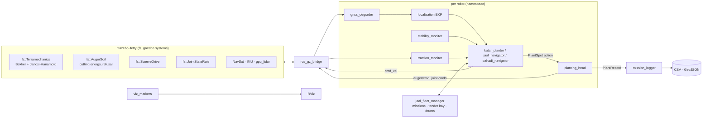

# ForestStark: afforestation robots

Three planting robots, each with a physics simulation and the software that would drive it:

| | Robot | Site | How it moves | Who decides where to stop |
|---|---|---|---|---|
| A | **Katar** (कतार, "row") | Roadsides, canal banks | 40 hp tractor + planting trailer, Ackermann steering | A driver steers. Software triggers stops every 3 m, and a boom sled and carriage put the auger on the spot |
| B | **Jaal** (जाल, "net") | Open blocks, 1–50 ha | Electric 4-wheel independent steer (swerve) | Fully autonomous fleet with a tender truck |
| C | **Pahadi** (पहाड़ी, "of the hills") | Slopes to ~25°, rocky land | Two tracked modules, steered articulation | Local autonomy on contour lines, operator on a tablet |

The workspace has three parts:

- **`ros2_ws/`**: ROS 2 Lyrical + Gazebo Jetty. Custom Gazebo systems for soil dynamics and plant handling, robot models, and the autonomy stack: localization, planting head, planners, fleet logistics, stability and traction monitoring.
- **`cad/`**: parametric CAD (CadQuery) of all three machines. It produces STEP assemblies, a bill of materials, the meshes Gazebo and RViz draw, and a browser CAD viewer. Link frames come from the robots' xacro files, so the CAD and the simulation share one kinematic definition.
- **`sim/`**: a browser simulation lab (three.js + canvas) with the same physics constants and control logic, live engineering diagrams and the equations. It is the quick, shareable twin of the Gazebo stack.

---

## 1. Build

Requirements: Ubuntu 26.04, ROS 2 Lyrical with `ros_gz`, Gazebo Jetty (`gz sim` 10), `python3-numpy`, `python3-yaml`.

```bash
cd ~/Projects/ForestStark/ros2_ws
source /opt/ros/lyrical/setup.bash
colcon build --symlink-install
source install/setup.bash
```

Tests (C++ soil core, Python library, robot models):

```bash
colcon test --packages-select fs_gazebo fs_description && colcon test-result --verbose
PYTHONPATH=src/fs_autonomy:src/fs_gazebo python3 -m pytest -q src/fs_autonomy/test
```

## 2. Run

Each launch regenerates its site (world, soil map, survey file) from the arguments, starts Gazebo, spawns the robot(s), bridges topics and starts the autonomy. Add `headless:=true rviz:=false` to run without windows and `rtf:=3` to run faster than real time if the CPU allows.

```bash
ros2 launch fs_bringup katar.launch.py                         # stop-and-go, 3 m spacing, RTK
ros2 launch fs_bringup katar.launch.py mode:=on_the_move       # never stops; speed governed by sled travel
ros2 launch fs_bringup katar.launch.py surveyed:=false         # no utility survey: watch for cable strikes
ros2 launch fs_bringup katar.launch.py gnss:=standard          # plain GNSS instead of RTK

ros2 launch fs_bringup jaal.launch.py                          # 3 robots, 0.09 ha demo block
ros2 launch fs_bringup jaal.launch.py robots:=4 field:=full    # 1 ha, 1,111 spots
ros2 launch fs_bringup jaal.launch.py rtk_policy:=wait dropouts:=6

ros2 launch fs_bringup pahadi.launch.py                        # 14° slope, laterite, arm downhill
ros2 launch fs_bringup pahadi.launch.py slope:=22 side:=uphill rock_cover:=0.4
ros2 run fs_autonomy operator pause                            # the operator's tablet: pause|resume|skip|estop|release
```

Every planting attempt is written to `~/.ros/fs_logs/<site>-<time>/plants.csv` and `plants.geojson`, with coordinates, species, tool, soil, hole depth, boring energy, cycle time and placement error. A `summary.json` and, for Jaal, `fleet_timeline.csv` are written alongside.

The browser lab needs no build. Serve `sim/` and open it:

```bash
python3 -m http.server 8765 --directory sim
```

Then open `http://localhost:8765/preview.html` in a browser.

To watch the plant handling up close, add `inspect:=true`. It mounts a fixed camera beside each robot's mechanism, publishing on `/model/<ns>/inspect_cam`. Show it in the Gazebo GUI with the Image Display plugin, or in RViz through a bridge.

## 2a. Plant handling

Every plug is tracked by the `fs::PlugInventory` Gazebo system. Each carrier cell (a drum pocket, carousel cup or tray cell) and each holder (gripper, duckbill) shows a plug while it holds one. The planting head drives the real joints, then tells the inventory what happened (`plugs/cmd`: `pick`, `move`, `drop`, `fill`, `empty`). It reads back counts and the world position of the next full cell (`plugs/status`). A feeder thread keeps the next plug staged while the robot drives and bores.

| | Store | Hand-off | Into the ground |
|---|---|---|---|
| Katar | Rack trays on the trailer; a loader tops up a 12-cup **carousel** over the chute (one cup every 4 s) | The carousel indexes the next cup over the chute and the plug drops into the **duckbill** | The **turret** carries the auger at +x and the duckbill at −x. After boring it swings 180°, the duckbill pushes in, the jaws open, it withdraws past the seedling's crown, and a tamp ring firms the soil |
| Jaal | Two **drums**, 4 tiers × 45 pockets (360 plugs) | A Cartesian **picker** under the roof (x rail, z column, y reach, two fingers) grips the root ball and carries it to a **funnel** feeding the duckbill | The rear **shuttle** swaps the duckbill over the hole the auger just made; then the same duckbill and tamp sequence as Katar |
| Pahadi | One 50-cell **active tray** in the arm's reach; three spares in the rear **magazine** | After boring, the arm turns the wrist level (gripper IK, `ik.solve_gripper`), picks the next cell's plug and carries it to the hole | The gripper lowers the plug, releases it and presses the soil, then the arm scrapes the half-moon bund. An empty tray triggers a tray swap |

The launch's `plugs` value sets the starting load: carriers are filled to it and the rest is held in reserve (racks or magazine). `head/status.plugs_left` counts everything on board, and a tender refill (`head/refill`) refills the drums.

## 2b. Safety

Every robot runs a **safety monitor** between its planner and its wheels: navigators publish `cmd_vel_nav`, and only the monitor publishes `cmd_vel`. It drops lidar hits on the ground itself, using the machine's roll and pitch and the survey's elevation map; on Pahadi's hillside the lidar plane otherwise meets the terrain a few metres away. It then clusters the scans and tracks the clusters in the wheel-odometry frame, which stays smooth when GNSS corrections make the map pose jump. The lidars are Jaal's front and rear, Katar's boom side, and Pahadi's front.

| Situation | Response |
|---|---|
| Person or animal within 1.2 m of the machine | Stop, in any direction, even while pivoting |
| Person in the path, or predicted to cross it within 3 s | Stop at 2.5 m; slow from 6 m |
| Static object in the path (stump, crate) | Stop at braking distance + 0.4 m (1.5 m at full speed, 0.5 m crawling); slow from 5 m |
| Person within 2 m of the auger or duckbill | **Tool hold**: the auger stops mid-hole (`fs::AugerSoil` `hold`/`resume`) and every mechanism joint freezes |
| E-stop (`/fleet/estop` true, or the operator tablet's `estop`) | Latched stop and tool hold until `release` |
| No command for 0.4 s; localization older than 1 s; off the site | Stop (watchdog, localization, geofence) |

An object counts as a person or an animal once it has covered 0.6 m within 2 s. A crate seen from a passing robot wobbles by up to half its size, and a track matched to the wrong cluster jumps; neither counts. Objects wider than 0.7 m never count as people. Neither do tracks that first appear at a surveyed stump, mound, boulder or tree, or within 0.5 m of a sapling the fleet has planted: seen side-on from a passing robot, a stump's outline shifts by up to a metre. While the robot drives or pivots, anything close to it has to cover twice the distance (1.2 m in 2 s), and beyond 10 m nothing is classified at all. Nothing counts as moving in the first 5 s after start-up.

A stop is released only after the zone has been clear for 2 s (3 s for the tool), so people stepping in and out don't make the machine lurch. What happens while stopped depends on the robot:

- **Jaal** goes round a static object after 20 s, on a side the monitor reports free, and stays out until its whole body is 1.5 m past it. If the object sits where Jaal must stop to plant, it skips that spot and logs the reason. A detour waypoint that stays blocked is dropped. It waits for people and animals, and passes one with extra clearance only if it has stood in the path for 60 s. If no side is free it waits and reports `needs_operator` after 120 s.
- **Pahadi** never improvises a detour on a slope. It waits, and reports `needs_operator` after 60 s.
- **Katar** is driven by a person. The monitor guards the boom's working strip beside the trailer and brakes the tractor if someone walks into it.

The state is published on `<ns>/safety/status` (`fs_interfaces/SafetyStatus`) and drawn in RViz (`/viz/safety`: tracked people and STOP / TOOL HOLD labels).

To test it, add `people:=all` to a launch: simulated people and a crate act out the scenarios against the robot (`jaal_1` for Jaal).

```bash
ros2 launch fs_bringup jaal.launch.py robots:=1 cows:=0 people:=all     # cross, tool, stand, obstacle
ros2 launch fs_bringup pahadi.launch.py people:=cross,tool              # pick scenarios
ros2 topic pub --once /fleet/estop std_msgs/msg/Bool "{data: true}"      # stop every robot
ros2 run fs_autonomy operator release jaal_1                            # release one
```

## 2c. CAD

```bash
python3 -m venv cad/.venv && cad/.venv/bin/pip install cadquery     # once
cad/.venv/bin/python cad/build.py              # all three robots (Jaal takes ~2.5 min)
cad/.venv/bin/python cad/build.py pahadi       # one robot
```

| Output | What it is |
|---|---|
| `cad/out/<robot>.step` | Full assembly, every link placed by its URDF joint (display pose) |
| `cad/out/katar_planting_head.step`, `jaal_plant_handling.step`, `pahadi_arm_and_gripper.step` | The plant-handling subsystem on its own |
| `cad/out/<robot>_bom.csv` | Parts, materials, volumes and estimated masses (volume × density × solid fraction) |
| `cad/out/<robot>.glb`, `<robot>_joints.json` | Assembly and joint tree for the viewer |
| `ros2_ws/src/fs_description/meshes/<robot>/<link>.obj` | Per-link visuals used by Gazebo and RViz (metres); trays use light proxies in the meshes and full cells in the STEP |

Estimated structural masses: Katar 4,155 kg (tractor and trailer), Jaal 1,498 kg, Pahadi 1,405 kg.

The viewer (`cad/viewer.html`) shows the part tree with BOM masses. It can isolate parts, explode the assembly, cut a section plane, pose every mechanism joint and animate one full plant cycle per robot, with the plug moving from the store into the ground. Serve `cad/` and open it:

```bash
python3 -m http.server 8766 --directory cad
```

Then open `http://localhost:8766/viewer.html`.

## 3. Architecture



### Packages

| Package | What is in it |
|---|---|
| `fs_interfaces` | `PlantRecord`, `HeadStatus`, `StabilityStatus`, `TractionStatus`, `Mission`, `Spot`, `RobotState`; action `PlantSpot`, action `TenderService`, service `ReserveBay` |
| `fs_gazebo` | C++ systems: `fs::Terramechanics`, `fs::AugerSoil`, `fs::PlugInventory`, `fs::SwerveDrive`, `fs::JointStateRate`; soil-map loader; site generator (`fs_gazebo.sites`) for the roadside, open-field and hill-slope worlds; scenery models |
| `fs_description` | xacro models: `katar`, `jaal`, `pahadi` (sensors, drives, soil systems, plant-handling joints and controllers); CAD meshes |
| `fs_autonomy` | Python library (`geometry`, `site`, `terramechanics`, `stability`, `planners`, `control`, `ekf`, `ik`, `head_model`) and nodes |
| `fs_bringup` | `katar.launch.py`, `jaal.launch.py`, `pahadi.launch.py`, RViz layouts, `fs_bringup.sim` launch helpers |

### Topics (per robot, e.g. `/jaal_1/...`)

| Topic | Type | From → to |
|---|---|---|
| `odom`, `imu`, `gnss/fix_raw`, `joint_states`, `scan` | sensor data | Gazebo → robot |
| `gnss/fix`, `gnss/status` | `NavSatFix`, `String` | gnss_degrader → localization |
| `localization/odom` + TF `map → ns/odom → ns/base_link` | `Odometry` | localization → all |
| `cmd_vel`, `joint/<j>/cmd_pos`, `auger/cmd` | commands | autonomy → Gazebo |
| `auger/status`, `terramechanics` | JSON `String` | Gazebo soil systems → head, traction monitor |
| `plugs/status` / `plugs/cmd` | JSON `String` / `String` | fs::PlugInventory ↔ planting_head |
| `cmd_vel_nav` → `cmd_vel` | `Twist` | navigator → safety_monitor → Gazebo |
| `safety/status`, `/fleet/estop` | `SafetyStatus`, `Bool` | safety_monitor → navigator, head, RViz; operator → all |
| `plant_spot` | `PlantSpot` action | navigator → planting_head |
| `head/status`, `stability`, `traction`, `state`, `mission` | fs_interfaces | robot → navigator, fleet, RViz |
| `/plants/records` | `PlantRecord` | planting_head → mission_logger, viz |
| `/fleet/reserve_bay`, `/fleet/tender_service` | service, action | Jaal navigators ↔ fleet manager |

`ground_truth` is published for evaluation only. The autonomy never reads it. The two exceptions are simulated humans: the Katar driver and the livestock.

## 4. Soil physics (what the Gazebo systems add)

Gazebo's rigid-body friction cannot represent soil, so the wheel and track collisions are almost frictionless (μ = 0.02) and `fs::Terramechanics` applies the soil forces at every contact on every step:

- **Normal load:** quasi-static least-norm distribution of the whole model's weight over the contacts touching the ground. On a slope this gives load transfer to the downhill side.
- **Sinkage and motion resistance (Bekker):** `z = (p / (kc/b + kφ))^(1/n)` and `Rc = b(kc/b + kφ) z^(n+1)/(n+1)`.
- **Traction (Janosi–Hanamoto):** `F = (A c + W tanφ)[1 − K/(i l)(1 − e^(−il/K))]`, longitudinal from slip and lateral from side-slip. A LuGre-type bristle state lets a stopped machine hold on a slope instead of creeping.
- **Auger cutting (`fs::AugerSoil`):** specific energy `e = e_b · (1.6 − 2.4·moisture)` and feed `min(f_max, η P / (e A))`, slowed when the thrust `0.012 e A` exceeds what the head can push. The reaction goes into the robot through the joints. Refusal at the soil map's depth to rock; percussive-pick mode through rock.

Soil constants (Wong, *Theory of Ground Vehicles*) and boring energies:

| Soil | n | kc kN/m^(n+1) | kφ kN/m^(n+2) | c kPa | φ ° | K m | e_b MJ/m³ |
|---|---|---|---|---|---|---|---|
| Dry sand | 1.10 | 0.99 | 1528 | 1.04 | 28 | 0.025 | 2.5 |
| Sandy loam | 0.90 | 52.5 | 1128 | 4.83 | 20 | 0.025 | 4 |
| Clayey soil | 0.50 | 13.2 | 692 | 4.14 | 13 | 0.020 | 9 |
| Heavy clay | 0.13 | 12.7 | 1556 | 68.9 | 34 | 0.010 | 14 |
| Lateritic gravel | 0.80 | 30 | 4000 | 10 | 35 | 0.015 | 22 |

## 5. What the simulations found

Measured in the Gazebo runs (default arguments):

| | Katar | Jaal ×3 | Pahadi |
|---|---|---|---|
| Placement error, mean | 3.5 cm | 3.6 cm | 2.4 cm |
| Time at each spot, timed head | 12.5 s | 13.3 s | ~111 s |
| Time at each spot, mechanisms modelled | 18 s | 17 s | 120–150 s |
| Boring energy per hole | 35 kJ (Ø15 × 30 cm) | 18.5 kJ (Ø12 × 25 cm) | ~100 kJ (dry laterite) |
| Throughput, timed head | ~205 /h | ~575 /h for the fleet | ~32 /h |

The first runs timed the place and close steps. The mechanism runs (short runs of 2–6 spots, one Jaal) move every joint, and placement error stayed at 1–5 cm. Throughput with the mechanisms has not been re-measured over a full mission.

Design points that came out of building and running it:

1. **Pahadi's 2 kW auger is the bottleneck in dry laterite.** It is both power- and thrust-limited (needs ~4 kN, has 2.5 kN), so each hole takes about 1.5 minutes. In the browser lab, raise the auger power or the soil moisture to see the effect.
2. **The GNSS antenna mast must be tilt-compensated on slopes.** At 14° of roll, Pahadi's 1.27 m mast puts the antenna 0.31 m sideways, and every hole landed 30 cm uphill until localization rotated the 3-D lever arm by IMU roll and pitch.
3. **A 2.8 m tracked machine cannot skid-steer on cohesive soil.** The turning resistance exceeds the tracks' shear capacity. Pahadi has to steer with its articulation, and contour U-turns must respect the 3.2 m minimum radius (omega turns when rows are closer).
4. **Jaal's cycle is dominated by auger travel, not cutting.** About 0.6 m of free travel down and 0.8 m back at 0.25–0.3 m/s. Lowering the gantry or speeding up the feed axis buys more than a bigger motor.
5. **Katar's stop-and-go spacing depends on the boom sled, not on the driver.** With a 0.8 s reaction time and 0.9 m/s² braking, the sled absorbs the stopping error. On-the-move planting only beats stop-and-go with a long sled (≥ 2 m).
6. **Katar's full 1,000 L tank sits ahead of the axle,** giving ~35 % tongue load at the start. Moving it rearward would bring it toward 10–15 %.
7. **Gazebo's NavSat noise is in degrees, not metres.** A 0.02 "m" sigma produced kilometre-scale jumps until it was converted (`common.xacro`).
8. **The plug's path, not the auger, sets the floor on Katar's and Jaal's cycle once the mechanisms are modelled.** The duckbill stroke and the tamp take about 5 s after the auger is out. Lowering the loaded duckbill to just above the ground while the auger bores, and closing the jaws only once they clear the seedling's crown, took Katar from 24 s to 18 s per spot.
9. **Ogre2's heightmap shader fails under headless EGL** as soon as a camera renders the hill world. Pahadi's terrain is drawn as a generated mesh (`hill_slope_terrain.obj`), and the heightmap remains the collision shape.
10. **Two more Gazebo pitfalls.** DART ignores `<heightmap><pos>` (the terrain model itself is raised instead), and `/world/<w>/create` applies the request's `pose` over the pose in the SDF. Before the planting head set the request pose, every sapling was stacked at the world origin, where Jaal's lidar saw them as an obstacle.

## 6. Limitations

- Terramechanics is applied per contact with a quasi-static load split. There is no bulldozing, multi-pass compaction or rut geometry, and tracks are modelled as three road-wheel segments per side.
- Stones are visual only in Gazebo; the soil map tells the auger where rock is.
- Plugs are visuals that the inventory moves between links. They are not dynamic bodies, so a dropped or crushed plug cannot be simulated. A plug is planted by spawning a sapling model at the hole.
- Gazebo's mass does not change as plugs and water are used. The stability monitor, and Katar's trailer-load diagram in the browser lab, account for it in software.
- The safety monitor is not a certified safety function (ISO 25119 / ISO 18497). It tells people from objects only by whether they move, uses planar lidars, and has blind spots: behind Pahadi's rear module, and ahead of Katar's tractor, where the driver is responsible.
- Jaal's lidars are single planar scans 0.30 m above ground: they see stumps, mounds, cattle and other robots, not stones. It needs GPU rendering (`--headless-rendering` works on this machine). With `lidar:=false` the safety field only knows other robots' positions. If the wheels spin without progress (traction monitor: immobilised), the navigator backs off and goes round.
- Simulation speed: three Jaal robots run at about 0.6× real time on this laptop.
